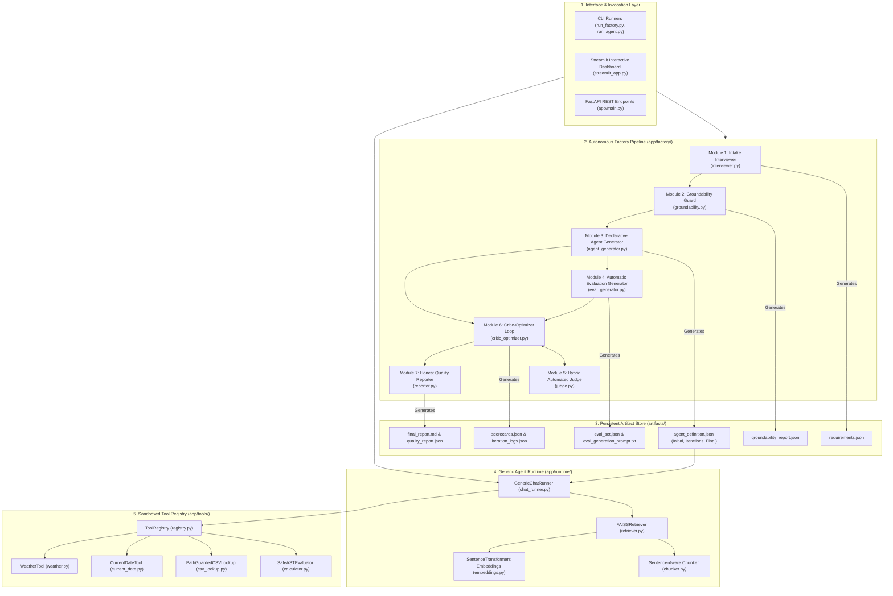
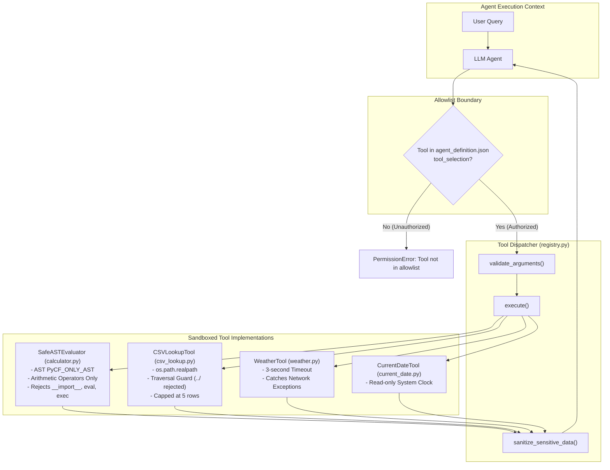
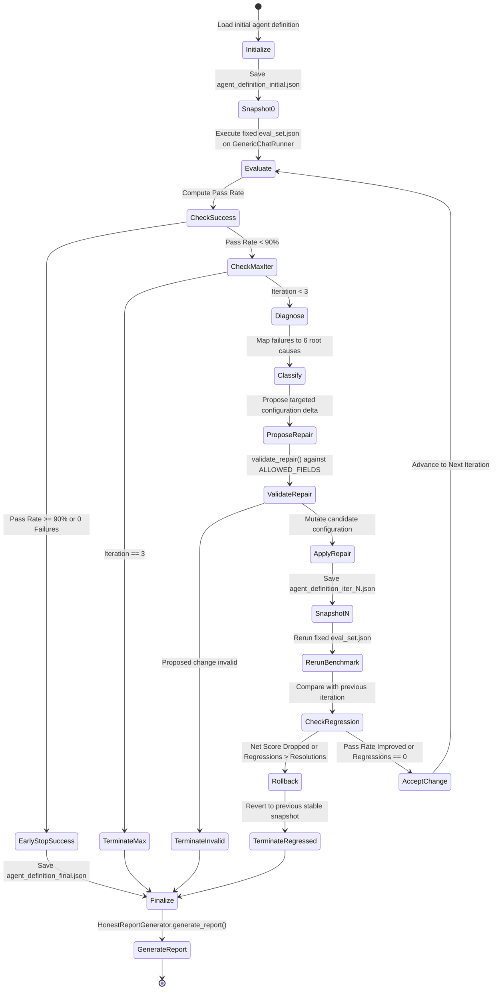

# ForgeAI: System Architecture & Technical Design Specification
**Document Version:** 2.0  
**Target Platform:** OceanAI Jr. GenAI Engineer Recruitment Technical Evaluation  
**Last Updated:** November 26, 2026  

---

## 1. High-Level Architectural Vision

ForgeAI decouples **Agent Manufacturing** from **Agent Execution**. 

Traditional systems blur prompt engineering, retrieval tuning, and application runtime into a single codebase. In contrast, ForgeAI operates as a **Compiler and Optimizer for Specialized AI Agents**:
- **Input Language:** Natural language briefs and raw document corpora (PDF, TXT, CSV).
- **Compilation Pipeline:** Intake analysis $\rightarrow$ Groundability verification $\rightarrow$ Declarative synthesis $\rightarrow$ Test benchmark generation $\rightarrow$ Closed-loop evaluation and repair.
- **Output Artifact:** A declarative, platform-agnostic, immutable specification (`agent_definition.json`) accompanied by audit certificates (`final_report.md`, `scorecards.json`).
- **Target Runtime:** A universal generic runtime (`GenericChatRunner`) with sandboxed tool execution and FAISS vector retrieval.

---

## 2. Component Topology & Data Flow

---

## 3. The 9 Core Production Modules

### Module 1: Intake Interviewer (`app/factory/interviewer.py`)
- **Class:** `IntakeInterviewer`
- **Responsibilities:**
  - Scans document folder via `DocumentLoader.load_directory()`.
  - Analyzes document formats, page counts, record counts, and char densities.
  - Extracts key domain topics via header regex patterns.
  - Formulates $\le 5$ clarifying questions for missing or ambiguous scope.
  - In unattended mode, applies conservative, deterministic defaults.
  - Outputs Pydantic `Requirements` (`requirements.json`).

### Module 2: Groundability Guard (`app/factory/groundability.py`)
- **Class:** `GroundabilityGuard`
- **Responsibilities:**
  - Audits `must_answer_topics` against raw corpus text via sentence-level token matching.
  - Extracts `EvidenceReference` objects containing source document, page number, and text excerpts.
  - Categorizes unsupported topics with `absence_nature` (`missing_from_corpus`, `inherently_nonexistent`, `unsupported_capability`).
  - Purges ungroundable topics from answerable scope and moves them to `must_refuse_topics`.
  - Outputs `GroundabilityReport` (`groundability_report.json`).

### Module 3: Declarative Agent Generator (`app/factory/agent_generator.py`)
- **Class:** `AgentGenerator`
- **Responsibilities:**
  - Analyzes document characteristics (file counts, formats, volume).
  - Dynamically configures adaptive chunk size (300-600) and overlap (60-120).
  - Configures adaptive retrieval top-k (3-5) and similarity threshold (0.32-0.38).
  - Evaluates tool necessity; provides explicit justification for every authorized tool.
  - Rejects irrelevant or unauthorized tools.
  - Dynamically constructs authoritative system prompt with strict refusal instructions.
  - Outputs declarative `AgentDefinition` (`agent_definition.json`).

### Module 4: Automatic Evaluation Generator (`app/factory/eval_generator.py`)
- **Class:** `AutomaticEvalGenerator`
- **Responsibilities:**
  - Extracts discrete verifiable facts, specifications, and procedures from documents.
  - Synthesizes at least 20 test cases spanning 8 distinct query archetypes.
  - Validates every expected fact against source document evidence.
  - Enforces duplicate prevention via token Jaccard similarity ($J \ge 0.65$ rejected).
  - Freezes the evaluation set (`eval_set.json`) for consistent cross-iteration comparison.

### Module 5: Automated Hybrid Judge (`app/factory/judge.py`)
- **Class:** `HybridJudge`
- **Responsibilities:**
  - Executes deterministic checks for refusal phrases, citation regex, fact token overlap, grounding overlap, and contract compliance.
  - Executes semantic LLM evaluation for completeness, semantic equivalence, and relevance with temperature 0.0.
  - Applies position-bias, verbosity-bias, self-preference, and uncertainty mitigations.
  - Categorizes responses into 6 discrete outcome classifications.
  - Outputs `CaseEvaluationResult` objects and aggregates `IterationScorecard`.

### Module 6: Critic–Optimizer Loop (`app/factory/critic_optimizer.py`)
- **Class:** `CriticOptimizer`
- **Responsibilities:**
  - Classifies failures into 6 root causes: `retrieval_miss`, `prompt_defect`, `hallucination`, `wrong_refusal`, `citation_defect`, `output_contract_violation`.
  - Enforces a strict maximum of 3 optimization iterations.
  - Validates proposed repairs against allowed target fields and parameter bounds.
  - Applies targeted prompt or hyperparameter updates without mutating unrelated components.
  - Saves configuration snapshots (`agent_definition_iter_*.json`).
  - Detects regressions on previously passing tests; rolls back degraded changes.
  - Supports early stopping upon achieving target pass rate ($\ge 90\%$) or stagnation.

### Module 7: Honest Quality Reporter (`app/factory/reporter.py`)
- **Class:** `HonestReportGenerator`
- **Responsibilities:**
  - Compiles all 14 mandatory audit sections.
  - Computes 6 standardized reproducible metrics directly from raw evaluation results.
  - Generates dual audit certificates: `final_report.md` (Markdown) and `quality_report.json` (JSON).
  - Preserves raw agent responses and judge evidence reasoning without fabrication.

### Module 8: Generic Agent Runtime (`app/runtime/chat_runner.py`)
- **Class:** `GenericChatRunner`
- **Responsibilities:**
  - Dynamically loads configuration from JSON file path, dict, or Pydantic instance.
  - Manages FAISS vector retrieval using agent-specific parameters.
  - Enforces pre-query refusal check against `must_refuse_topics`.
  - Dispatches allowlisted tools with argument validation.
  - Evaluates safe AST math expressions and path-guarded CSV queries.
  - Assembles grounded context with source and page attribution.
  - Sanitizes sensitive credentials and masks tokens in agent responses.
  - Validates output contracts and manages multi-turn conversation history.

### Module 9: Verified Demonstrations & Generalization (`demos/`, `unseen_test/`)
- **Responsibilities:**
  - Demo 1 (HR Assistant): Verifies pure text PDF processing and tool isolation (only `current_date` authorized).
  - Demo 2 (Procurement Assistant): Verifies mixed tabular CSV + PDF retrieval with `csv_lookup` and `calculator` tools.
  - Demo 3 (Academic Regulations): Verifies zero-code-change unseen domain generalization in unattended mode.

---

## 4. Security Architecture & Isolation Boundaries

---

## 5. RAG Pipeline & Vector Indexing Architecture

### 1. Ingestion & Preprocessing
- PDF text extracted page-by-page via `PyMuPDF` (`fitz`).
- CSV spreadsheets ingested via `pandas`, converting rows into stringified key-value passages.
- TXT/Markdown loaded with UTF-8 normalization.

### 2. Sentence-Aware Chunking
- Text is split into natural sentences using regex `(?<=[.!?])\s+`.
- Chunks accumulate sentences up to `chunk_size` characters with a sliding overlap of `chunk_overlap` characters.
- Metadata is attached to every chunk: `source`, `page`, `chunk_id`, `file_type`.

### 3. Vector Embedding
- Embeddings are generated using `sentence-transformers/all-MiniLM-L6-v2` (384 dimensions).
- Multi-threading is locked to single CPU thread (`torch.set_num_threads(1)`) to eliminate PyTorch segmentation faults on macOS Apple Silicon.

### 4. FAISS Search & Thresholding
- Vectors are L2-normalized:
  $$\mathbf{v}_{\text{norm}} = \frac{\mathbf{v}}{\|\mathbf{v}\|_2}$$
- Stored in a `faiss.IndexFlatIP` index.
- Search queries are similarly normalized, so inner product equals cosine similarity.
- Top-$k$ candidates are retrieved and filtered against `similarity_threshold`.

---

## 6. Optimization Loop State Machine

---

## 7. Runtime Architecture & Memory Model

- **Stateless Agent Configuration:** The generated agent definition is entirely captured in `agent_definition.json`.
- **Stateless Document Index:** The document index can be re-indexed on the fly or persisted as a `.faiss` index and loaded on cold start.
- **Dynamic Definition Loading:** `GenericChatRunner` supports dynamic instantiation via file path, Python dictionary, or Pydantic instance.
- **Conversation State Isolation:** Multi-turn history is stored in an in-memory list of message dictionaries (`[{"role": "user", "content": "..."}, {"role": "assistant", "content": "..."}]`) and can be explicitly reset via `reset_history()`.
- **Thread Safety:** The retrieval engine, FAISS index, and tool registry are fully thread-safe for concurrent read access.
