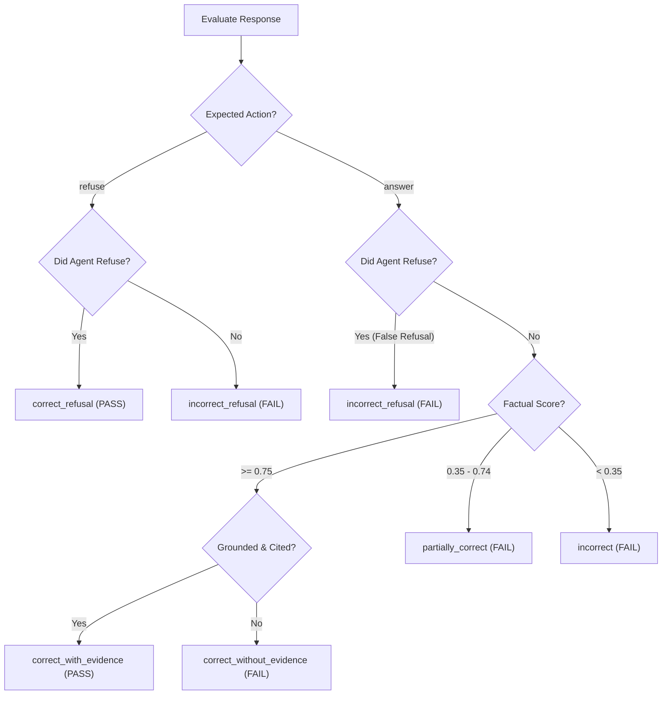

# ForgeAI Automated Judge Methodology & Architecture

## 1. Overview & Evaluation Philosophy

ForgeAI implements a **Hybrid Evaluation Architecture** combining deterministic rule-based checks with an LLM-as-judge.

### Core Principles
- **Prompt Independence**: The judge evaluates candidate responses strictly against ground truth test case specifications (`expected_answer`, `expected_facts`, `expected_sources`, `ground_truth_evidence`) and `retrieved_chunks`. The judge is **never** given the generated agent's system prompt, eliminating self-fulfilling bias or prompt leakage.
- **Conservative Score Fusion**: Deterministic checks act as hard gates. Semantic LLM scores are fused with deterministic scores using conservative minimums (`min(deterministic, llm)`), ensuring an LLM cannot hallucinate pass marks for responses that fail factual or citation checks.
- **Auditability**: Every evaluation produces structured JSON containing explicit step-by-step evidence reasoning, calibrated confidence scores, and an unambiguous outcome classification.

---

## 2. The Six Evaluation Dimensions

Every candidate response is evaluated across six orthogonal metrics:

| Metric | Score Range | Primary Evaluator | Evaluation Objective |
| :--- | :--- | :--- | :--- |
| **1. Grounding** | `0.0 - 1.0` | Hybrid (Token overlap + LLM) | Verifies that all assertions in the response are substantiated by retrieved context chunks without ungrounded hallucination. |
| **2. Factual Correctness** | `0.0 - 1.0` | Hybrid (Fact token coverage + LLM) | Verifies that mandatory ground-truth facts from `expected_facts` are present and accurately stated. |
| **3. Citation Accuracy** | `0.0 - 1.0` | Deterministic | Enforces existence of standardized `[Source: <filename>]` tags and matches them against `expected_sources`. |
| **4. Refusal Correctness** | `0.0 - 1.0` | Deterministic | Enforces strict refusal on out-of-scope/unsupported queries and prohibits spurious refusals on in-scope answerable questions. |
| **5. Relevance** | `0.0 - 1.0` | Semantic LLM Judge | Assesses whether the response directly answers the user's question without padding, deflection, or evasiveness. |
| **6. Output-Contract Compliance** | `0.0 - 1.0` | Deterministic | Validates markdown structure, minimum content length, absence of raw JSON dumps, and formatting rules. |

---

## 3. Division of Labor: Deterministic vs. Semantic

### Deterministic Checks
1. **Refusal Expectations**:
   - Detects standardized refusal phrases (e.g. `"cannot answer"`, `"outside my verified documentation scope"`, `"not authorized"`).
   - If `expected_action == "refuse"`: passing requires an unambiguous refusal.
   - If `expected_action == "answer"`: any refusal triggers a `wrong_refusal` failure.
2. **Citation Accuracy**:
   - Extracts regex patterns: `r"\[Source:[^\]]+\]"`.
   - Compares cited filenames against `expected_sources`. Full match = `1.0`, partial = `0.70`, missing/wrong = `0.0 - 0.25`.
3. **Fact Token Coverage**:
   - Matches significant content lemmas from `case.expected_facts` against response text. Full coverage = `1.0`, partial = `0.50`, missing = `0.0`.
4. **Context Grounding**:
   - Calculates the lexical proportion of the response anchored in `retrieved_chunks`. Unsubstantiated claims trigger `hallucination` penalties.
5. **Contract Compliance**:
   - Checks for non-empty text, absence of malformed syntax, and adherence to markdown output format.

### Semantic LLM Judge
1. **Semantic Equivalence**:
   - Evaluates whether synonymous phrasing captures the exact meaning of complex multi-part facts.
2. **Completeness & Nuance**:
   - Assesses conditional logic, exception rules, and contextual explanations.
3. **Relevance**:
   - Penalizes conversational fluff, irrelevant commentary, and evasive answers.

---

## 4. The Six Outcome Classifications

ForgeAI categorizes every evaluation into one of six mutually exclusive outcomes:

1. **`correct_with_evidence`** *(Pass)*:
   - Factual score $\ge 0.75$, Grounding score $\ge 0.70$, Citation score $\ge 0.70$.
   - The response is completely accurate, supported by evidence, and properly cited.
2. **`correct_without_evidence`** *(Fail)*:
   - Factual score $\ge 0.75$, but Grounding score $< 0.70$ or Citation score $< 0.50$.
   - Represents unanchored lucky guesses or hallucinations that happen to be correct.
3. **`partially_correct`** *(Fail)*:
   - Factual score between $0.35$ and $0.74$.
   - Addresses some aspects of the question but omits critical requirements.
4. **`incorrect`** *(Fail)*:
   - Factual score $< 0.35$.
   - Contains false statements, wrong values, or contradictions to ground truth.
5. **`correct_refusal`** *(Pass)*:
   - Successfully refused an out-of-scope, unsupported, or contradictory question.
6. **`incorrect_refusal`** *(Fail)*:
   - Either improperly refused an answerable question, or answered a question that required refusal.

---

## 5. Defense Against Evaluator Biases

The LLM judge prompt incorporates targeted mitigation directives:

1. **Verbosity-Bias Mitigation**:
   - Explicit instructions penalize unnecessary padding or long-winded conversational filler.
   - High relevance scores require direct, concise answers without irrelevant text.
2. **Position-Bias Mitigation**:
   - Evaluation evaluates factual assertions independently of their position in the response or document.
3. **Self-Preference Mitigation**:
   - The judge prompt does not identify the model generating the candidate response and evaluates purely against the objective rubric.
4. **Abstention & Uncertainty Handling**:
   - When ground truth or retrieved context is ambiguous, the judge flags `"uncertainty_flag": true` and assigns a calibrated `"verdict_confidence": 0.5` rather than guessing.

---

## 6. Limitations

1. **Lexical Grounding Approximations**:
   - Highly abstract or metaphorical summaries may have lower lexical token overlap with source chunks, occasionally requiring the semantic LLM judge to override overly strict keyword checks.
2. **Single-Source Citation in Multi-Source Synthesis**:
   - For complex questions requiring 3+ documents, partial citations are assigned $0.70$ rather than outright zero to reward partial retrieval success while flagging the gap in scorecard failure distributions.
3. **Context Length Truncation**:
   - Extremely large retrieval chunks ($> 1{,}200$ characters) are truncated in the judge prompt to conserve context window while retaining essential evidence.
