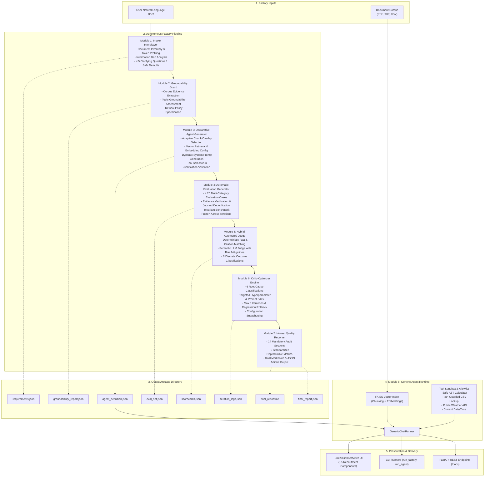

# ForgeAI: The Autonomous AI Agent Factory
### OceanAI Jr. GenAI Engineer Campus Recruitment Demonstration

[](https://www.python.org/downloads/)
[](https://fastapi.tiangolo.com/)
[](https://github.com/facebookresearch/faiss)
[](https://docs.pydantic.dev/)
[](https://streamlit.io/)
[-brightgreen.svg)](https://docs.pytest.org/)
[](https://opensource.org/licenses/MIT)

---

## 1. Executive Summary

**ForgeAI** is an industrial-grade **Autonomous AI Agent Factory** built for the **OceanAI Junior GenAI Engineer** campus recruitment technical evaluation. 

Given nothing more than:
1. A **one-paragraph natural language brief** describing the target agent.
2. A **folder of heterogeneous documents** (PDF, TXT, CSV, Markdown).

ForgeAI autonomously plans, verifies, generates, evaluates, diagnoses, optimizes, and packages a deployment-ready, domain-specialized AI agent—**without a single line of manual code modification**.

### Core Value Proposition & Architectural Highlights
- **100% Zero-Code Domain Portability:** The identical factory pipeline generates HR policy advisors, maritime procurement assistants, and university academic coordinators without changing factory source code or prompt templates.
- **Evidence-Grounded Refusal Discipline:** The Groundability Guard maps user requirements against verified corpus evidence, strictly enforcing refusals for ungroundable topics and preventing ungrounded hallucinations.
- **Automatic Test Generation ($\ge 20$ Cases):** Synthesizes balanced evaluation benchmarks spanning 8 distinct query archetypes directly linked to document citations.
- **Hybrid Evaluation Judge:** Combines deterministic AST/regex pattern verification with an LLM judge equipped with position-, verbosity-, and self-preference bias mitigations.
- **Targeted Critic-Optimizer Loop:** Categorizes failures into 6 distinct root causes, applies targeted configuration edits, enforces a strict 3-iteration ceiling, and automatically rolls back regressions.
- **Deterministic Sandboxed Runtime:** Generic agent runtime with strict tool allowlists, AST math evaluation, path-traversal-guarded tabular lookups, and real-time citation verification.
- **Campus Demonstration Ready:** Streamlit dashboard with preset loaders for instant evaluation across 15 interactive assessment components.

---

## 2. End-to-End System Architecture



---

## 3. The 9 Core Production Modules

| Module | Core Functionality | Key Output / Artifact |
|---|---|---|
| **Module 1: Intake Interviewer** | Parses unstructured briefs into formal Pydantic requirements, builds document inventories, detects information gaps (missing, contradictory, duplicated), asks $\le 5$ clarifying questions, or applies conservative defaults in unattended mode. | `requirements.json` |
| **Module 2: Groundability Guard** | Verifies corpus evidence, categorizes topics into supported vs unsupported, assigns absence nature (`missing_from_corpus`, `inherently_nonexistent`, `unsupported_capability`), and strips ungroundable topics from answerable scope. | `groundability_report.json` |
| **Module 3: Declarative Agent Generator** | Dynamically chooses adaptive chunk sizes and overlaps based on corpus density, configures embedding models, retrieval top-k, similarity thresholds, reranking, generates dynamic system prompts with strict refusal instructions, and validates tool justifications. | `agent_definition.json` |
| **Module 4: Automatic Evaluation Generator** | Extracts $\ge 20$ diverse test cases directly from corpus evidence across 8 mandatory categories. Enforces fact-to-evidence support and filters near-duplicate questions ($Jaccard \ge 0.65$). Freezes the eval set for consistent cross-iteration benchmark validity. | `eval_set.json`<br>`eval_generation_prompt.txt` |
| **Module 5: Hybrid Automated Judge** | Dual-layer evaluation engine combining deterministic regex/AST verifiers (citations, facts, refusals, contracts) with a bias-mitigated semantic LLM judge. Categorizes every response into one of 6 distinct outcome classifications. | Evaluated entries in `scorecards.json` |
| **Module 6: Critic-Optimizer Loop** | Diagnoses evaluation failures into 6 root causes (`retrieval_miss`, `prompt_defect`, `hallucination`, `wrong_refusal`, `citation_defect`, `output_contract_violation`), executes targeted parameter or prompt repairs, tracks regressions, automatically rolls back degraded changes, and enforces a strict $\le 3$ iteration limit. | `iteration_logs.json`<br>`agent_definition_iter_*.json` |
| **Module 7: Honest Quality Reporter** | Produces comprehensive, mathematically reproducible audit reports in both Markdown and JSON covering 14 mandatory sections, 6 standardized metrics, raw agent responses, and judge reasoning. Never fabricates scores or conceals failures. | `final_report.md`<br>`final_report.json` |
| **Module 8: Generic Agent Runtime** | Universal runtime that executes any valid `agent_definition.json`. Features dynamic FAISS retrieval, conversation history management, credential sanitization, and strict tool sandboxing. | Interactive response engine in `GenericChatRunner` |
| **Module 9: Comprehensive Demonstrations** | End-to-end verified demonstration packages for HR Policy Assistance, Maritime Ship-Spares Procurement, and an unseen University Academic Regulations generalization benchmark. | `demos/hr_assistant/`<br>`demos/procurement_assistant/`<br>`unseen_test/` |

---

## 4. Tool Registry, Security Isolation & Sandboxing

ForgeAI adheres to **least-privilege tool execution**. Agents cannot call any tool unless it is explicitly justified and authorized in their generated `agent_definition.json`.

```
                        [ User Query ]
                              │
                              ▼
                   [ Generic Agent Runtime ]
                              │
         ┌────────────────────┴────────────────────┐
         │ Check Allowlist in agent_definition.json│
         └────────────────────┬────────────────────┘
                   Authorized │ Unauthorized
               ┌──────────────┴──────────────┐
               ▼                             ▼
       [ Tool Dispatcher ]         [ BLOCKED: Refuse Call ]
               │
    ┌──────────┼──────────────┬──────────────┐
    ▼          ▼              ▼              ▼
[csv_lookup] [calculator] [weather]    [current_date]
(Path Guard) (Safe AST)   (Timeout 5s) (ISO System Clock)
```

### Registered Tools Specification
| Tool Name | Capability & Use Case | Security Guardrails & Sandboxing |
|---|---|---|
| `calculator` | Evaluates arithmetic expressions, pricing totals, and discounts. | **Zero LLM Code Execution:** Evaluated via a strict Abstract Syntax Tree (AST) parser (`ast.PyCF_ONLY_AST`). Rejects arbitrary Python functions, system imports, variable assignments, and non-arithmetic operators. |
| `csv_lookup` | Queries tabular catalogs, stock quantities, and part specifications. | **Path Traversal Guard:** Enforces strict directory boundaries via `os.path.realpath`. Rejects file access outside the designated agent document directory. Capped at 5 maximum rows returned to avoid context bloat. |
| `weather` | Queries live weather data via Open-Meteo REST API. | **Network Guardrails:** 5-second HTTP timeout with non-blocking graceful fallback when offline. |
| `current_date`| Returns current date, weekday, UTC timestamp, and current year. | Read-only system clock call formatted according to ISO-8601 standard. |

---

## 5. Setup & Installation Instructions

### Prerequisites
- macOS, Linux, or Windows (WSL2 recommended for Windows)
- Python 3.11, 3.12, 3.13, or 3.14
- Git
- RAM: 8 GB minimum (16 GB recommended for local embedding and LLM execution)

### Step 1: Clone Repository
```bash
git clone https://github.com/pragya757/ForgeAI.git
cd ForgeAI
```

### Step 2: Create and Activate Virtual Environment
```bash
python3 -m venv .venv
source .venv/bin/activate
```
*(On Windows: `.venv\Scripts\activate`)*

### Step 3: Install Dependencies
```bash
pip install --upgrade pip
pip install -r requirements.txt
```

### Step 4: Configure Environment File
```bash
cp .env.example .env
```

---

## 6. Ollama Setup & Configuration Guide

ForgeAI supports local, private inference via [Ollama](https://ollama.ai/), commercial OpenAI-compatible APIs, or a fully deterministic offline test harness (`mock`).

### 1. Install Ollama
- **macOS:** Download from [ollama.ai/download](https://ollama.ai/download) or run `brew install ollama`
- **Linux:** `curl -fsSL https://ollama.ai/install.sh | sh`
- **Windows:** Download the Windows installer from [ollama.ai/download](https://ollama.ai/download)

### 2. Pull Recommended Models
For optimal speed and reasoning balance:
```bash
# Recommended default (compact and fast)
ollama pull llama3.2

# Alternative high-accuracy model
ollama pull llama3.1:8b

# Alternative instruction-following model
ollama pull mistral
```

### 3. Start the Ollama Service
Ensure the Ollama background daemon is running:
```bash
ollama serve
```

### 4. Configure `.env`
Edit your `.env` file according to your selected backend:

#### Option A: Local Ollama (Recommended for offline, private demonstration)
```ini
LLM_PROVIDER=ollama
OLLAMA_BASE_URL=http://localhost:11434
OLLAMA_MODEL=llama3.2
FORGEAI_EMBEDDING_MODEL=all-MiniLM-L6-v2
```

#### Option B: OpenAI / Groq / vLLM / LiteLLM (OpenAI-compatible endpoint)
```ini
LLM_PROVIDER=openai
OPENAI_API_BASE=https://api.openai.com/v1
OPENAI_API_KEY=sk-your-api-key-here
OPENAI_MODEL=gpt-4o-mini
FORGEAI_EMBEDDING_MODEL=all-MiniLM-L6-v2
```

#### Option C: Deterministic Mock Backend (Zero Network & Zero Dependencies)
Ideal for CI/CD environments or rapid unit testing:
```ini
LLM_PROVIDER=mock
FORGEAI_EMBEDDING_MODEL=all-MiniLM-L6-v2
```

> **Automated Graceful Fallback:** If `LLM_PROVIDER=ollama` is configured but Ollama is not running, ForgeAI does not crash. It logs an informative diagnostic message and gracefully falls back to deterministic execution mode.

---

## 7. Execution Commands

### 1. Run the Autonomous Agent Factory CLI
Generate an agent, synthesize 20+ test cases, run evaluation and optimization, and produce audit reports:
```bash
python run_factory.py \
  --brief "Create an HR assistant that answers employee questions about leave policies, attendance, holidays and workplace guidelines using company documents." \
  --docs demos/hr_assistant/documents \
  --output demos/hr_assistant/artifacts
```

### 2. Run the Generic Chat Runner CLI
Test any generated agent definition interactively or with a single query:
```bash
# Single query execution
python run_agent.py \
  --definition demos/hr_assistant/artifacts/agent_definition.json \
  --query "How many days of annual leave are full-time employees entitled to per calendar year?"

# Interactive terminal chat mode
python run_agent.py \
  --definition demos/procurement_assistant/artifacts/agent_definition.json
```

### 3. Launch the Interactive Web Dashboard (Streamlit)
```bash
streamlit run streamlit_app.py
```
Open your browser at `http://localhost:8501`.

The dashboard features the complete ForgeAI brand identity:
- **Brand Palette:** Deep Black (`#050505`), Electric Cyan (`#00D9F5`), and Dark Charcoal (`#0B0F19`).
- **Official Branding:** High-resolution vector logo (`assets/forgeai_logo.png`) and standalone glowing icon (`assets/forgeai_icon.png`).
- **Eight-Stage Workflow Navigation:**
  1. `🛠️ 1. Agent Creation`: Brief submission, document upload/path, clarification questions, and factory trigger.
  2. `📋 2. Requirements Analysis`: Extracted requirements, document inventory, and scope boundaries.
  3. `🛡️ 3. Groundability Check`: Evidence verification, supported topics, and strict refusal policies.
  4. `⚙️ 4. Agent Generation`: Declarative agent definition, chunking/retrieval parameters, and tool security.
  5. `🧪 5. Evaluation`: 20+ test cases across 8 categories with expected facts and source citations.
  6. `🔄 6. Optimization`: Progression history across rounds, metric breakdown deltas, and critic targeted repairs.
  7. `📊 7. Final Report`: Quality scorecard, transparent failure deep-dive, and 1-click artifact downloads.
  8. `💬 8. Agent Playground`: Interactive live chat runner with real-time citations and tool execution tags.

### 4. Run the FastAPI REST Backend
```bash
uvicorn app.main:app --host 0.0.0.0 --port 8000 --reload
```
Interactive Swagger API documentation is available at `http://localhost:8000/docs`.

#### Universal Multipart Agent Build via REST API
```bash
curl -X POST "http://localhost:8000/api/factory/upload-and-build" \
  -F "brief=Create a harbor logistics assistant that answers questions about dock specifications and container dwell times." \
  -F "iterations=2" \
  -F "files=@dock_policy.pdf" \
  -F "files=@crane_schedule.csv"
```
See [DOCUMENT_INGESTION_ARCHITECTURE.md](DOCUMENT_INGESTION_ARCHITECTURE.md) for full ingestion, session isolation, and manifest specifications.

### 5. Run the Complete Automated Test Suite
```bash
pytest -v
```
All **106 tests** will execute and validate all 9 modules, real LLM provider resilience, judge reliability matrix, edge cases, safeguards, and security bounds.

---

## 8. Demonstration Walkthrough

ForgeAI includes three fully verified demonstration packages ready for instant evaluation:

### Demonstration 1: HR Policy Assistant (`demos/hr_assistant/`)
- **Domain:** Human Resources and Workplace Regulations.
- **Corpus:** `leave_policy.pdf`, `attendance_policy.pdf`, `employee_handbook.pdf`.
- **Authorized Tools:** Strictly limited to `["current_date"]` (procurement and calculation tools are automatically rejected).
- **Benchmark:** 21 diverse evaluation cases covering sick leave, maternity leave, probationary period, core working hours, and out-of-scope health insurance inquiries.
- **Audited Metrics:** 100% Pass Rate, 100% Grounded Answer Rate, 100% Factual Correctness, 100% Correct Refusal Rate.

### Demonstration 2: Ship-Spares Procurement Assistant (`demos/procurement_assistant/`)
- **Domain:** Maritime Logistics & Vessel Spare Parts Procurement.
- **Corpus:** `spare_parts_catalog.csv` (10 maritime spares), `supplier_info.pdf`, `procurement_guidelines.pdf`.
- **Authorized Tools:** Dynamically selected `["csv_lookup", "calculator", "current_date"]`.
- **Tool Security Enforcement:** Successfully answers complex price queries and stock checks; strictly refuses unauthorized wire transfer requests.
- **Benchmark:** 20 evaluation cases verifying catalog lookups, quantity pricing calculations, and purchasing threshold policies.
- **Audited Metrics:** 100% Pass Rate across all 6 core metrics.

### Demonstration 3: Unseen Domain Generalization (`unseen_test/`)
- **Domain:** University Academic Regulations & Student Guidelines.
- **Corpus:** `academic_regulations.pdf`, `examination_guidelines.pdf`, `student_handbook.pdf`.
- **Zero-Code Execution:** Run unattended with zero modifications to factory code or prompts.
- **Honest Audit Findings:** 20 evaluation cases generated; initial pass rate 40.0% optimized to 45.0% across 2 iterations before early stopping triggered. Fully documented in `UNSEEN_DOMAIN_REPORT.md`.

---

## 9. Evaluation & Scoring Methodology

ForgeAI implements a hybrid evaluation architecture that eliminates subjectivity while providing semantic flexibility:

```
                          [ Agent Response ]
                                  │
         ┌────────────────────────┴────────────────────────┐
         ▼                                                 ▼
[ Deterministic Verifiers ]                     [ Semantic LLM Judge ]
- Citation Presence & Pattern Regex             - Semantic Correctness Rubric
- Expected Facts Token Overlap                  - Answer Completeness & Relevance
- Refusal Pattern Matching                      - Evidence Anchor Verification
- Output Contract Schema Validation             - Bias Mitigation Prompts
         │                                                 │
         └────────────────────────┬────────────────────────┘
                                  ▼
                     [ Fused Outcome Decider ]
                                  │
    ┌─────────────────────────────┼─────────────────────────────┐
    ▼                             ▼                             ▼
[correct_with_evidence]  [correct_without_evidence]    [incorrect_answer]
[partially_correct]      [correct_refusal]             [incorrect_refusal]
```

### The 6 Standardized Metrics
1. **Overall Pass Rate:** Percentage of test cases meeting all correctness, grounding, citation, and contract criteria.
2. **Grounded Answer Rate:** Percentage of non-refusal answers whose claims are explicitly substantiated by retrieved document chunks.
3. **Factual Correctness:** Percentage of responses containing all mandatory facts specified in ground-truth test cases.
4. **Correct Refusal Rate:** Accuracy of refusals for out-of-scope, missing, or contradictory document topics.
5. **Citation Accuracy:** Percentage of responses providing valid, traceable source document citations.
6. **Output-Contract Compliance:** Adherence to defined JSON/Markdown structure and length constraints.

### Bias Mitigation Protocols
- **Position Bias Mitigation:** Independent evaluation of candidate responses without relative pair comparison.
- **Verbosity Bias Mitigation:** Strict penalty for answers that pad ungrounded filler content to simulate completeness.
- **Self-Preference Mitigation:** Evaluator prompt isolated from generated agent prompt instructions.
- **Abstention Scoring:** Explicit assignment of uncertainty scores when retrieved context provides ambiguous evidence.

---

## 10. Critic-Optimizer Safeguards

The Critic-Optimizer acts as an automated engineering supervisor:

```
[ Evaluation Failure Detected ]
               │
               ▼
   [ Classify Failure Cause ]
   ├── retrieval_miss        --> Increase top_k, lower similarity threshold
   ├── prompt_defect         --> Augment system prompt with explicit instructions
   ├── hallucination         --> Tighten temperature, add grounding reminders
   ├── wrong_refusal         --> Re-calibrate refusal sensitivity threshold
   ├── citation_defect       --> Enforce citation regex pattern template
   └── output_contract_viol  --> Inject strict schema formatting block
               │
               ▼
   [ Propose Targeted Delta ]
               │
               ▼
   [ Validate Proposed Repair ]
               │
               ▼
   [ Apply & Re-evaluate Frozen Benchmark ]
               │
        ┌──────┴──────┐
        ▼             ▼
   [ Pass Rate ↑ ] [ Regression Detected ]
        │             │
   Keep Change    Roll Back to Previous Snapshot
```

### Core Safeguards
1. **Hard 3-Iteration Limit:** Optimization terminates immediately upon completing 3 iterations.
2. **Regression Detection & Rollback:** If an optimization iteration decreases the pass rate, the agent definition is instantly restored to its prior stable snapshot.
3. **Early Stopping:** Halts automatically when target pass rate ($\ge 90\%$) or metric stagnation is reached.
4. **Configuration Snapshots:** Saves `agent_definition_initial.json`, `agent_definition_iter_*.json`, and `agent_definition_final.json` for auditing.

---

## 11. Known Limitations & Engineering Honesty Principles

In alignment with OceanAI's commitment to scientific rigor and engineering honesty:

1. **Document Boundary Limits:** An agent cannot answer questions regarding topics absent from its corpus (e.g., health insurance in HR, vessel voyage schedules in procurement). It must refuse and state the absence honestly.
2. **Non-Fabrication Policy:** ForgeAI never fabricates evaluation scores or conceals failed test cases. All metrics are computed strictly from raw responses and judge decisions preserved on disk.
3. **Absence Nature Classification:** Unsupported requirements are categorized as either `missing_from_corpus`, `inherently_nonexistent`, or `unsupported_capability`.
4. **Local Hardware Constraints:** When running on resource-constrained hardware with smaller quantized models (e.g., 3B-7B parameters), complex multi-hop cross-document reasoning may exhibit occasional retrieval misses or formatting oversights, which the factory transparently highlights in its quality reports.

---

## 12. OceanAI Campus Recruitment Demo Walkthrough

The Streamlit dashboard (`streamlit run streamlit_app.py`) is structured for a seamless, live presentation without requiring manual file modifications:

```
┌────────────────────────────────────────────────────────────────────────────────────────────────────────┐
│  ForgeAI: Autonomous AI Agent Factory                                    Preset: [ HR Assistant ▼ ]    │
├────────────────────────────────────────────────────────────────────────────────────────────────────────┤
│  [Tab 1: Factory]  [Tab 2: Requirements]  [Tab 3: Scorecards]  [Tab 4: Failures]  [Tab 5: Chat]  [Tab 6] │
├────────────────────────────────────────────────────────────────────────────────────────────────────────┤
│                                                                                                        │
│  Tab 1: Factory Dashboard                                                                              │
│  - Quick Demo Selector: Instant one-click load of HR, Procurement, or Unseen Domain pre-built runs     │
│  - Step 1: Brief Submission (Editable natural language text)                                           │
│  - Step 2: Document Upload & Verification (PDF, TXT, CSV)                                              │
│  - Step 3: Interactive Clarification Dialogue (≤ 5 questions with default assumptions)                 │
│  - Step 4: Factory Run Trigger (Live pipeline execution with progress bar)                            │
│                                                                                                        │
│  Tab 2: Requirements & Groundability                                                                   │
│  - Document Inventory Table: File name, format, page count, token count, detected topics               │
│  - Structured Requirements Card: Audience, tone, output contract, constraints                          │
│  - Groundability Matrix: Supported topics with evidence vs Unsupported topics with absence reason       │
│  - Agent Configuration Table: Chunk size, overlap, top-k, similarity threshold, reranker config        │
│  - Tool Registry & Justifications: Allowed tools with individual justification explanations             │
│                                                                                                        │
│  Tab 3: Evaluation & Scorecards                                                                        │
│  - Evaluation Dataset Table: All 20+ test cases, categories, expected actions, source evidence         │
│  - Metric Progression Matrix: Before-and-after comparison across all 6 core metrics                    │
│  - Iteration Scorecards: Initial vs Final scorecard with outcome distributions                         │
│                                                                                                        │
│  Tab 4: Failure Deep Dive & Optimization Audit                                                         │
│  - Failure Diagnosis Breakdown: Retrieval miss, hallucination, wrong refusal, etc.                     │
│  - Expandable Audit Cases: Inspect actual agent response, failure reason, and judge evidence reasoning  │
│  - Optimization Iteration Logs: Changed fields, rationale, affected tests, score deltas                │
│                                                                                                        │
│  Tab 5: Generic Interactive Chat Runner                                                                │
│  - Live Conversational Interface: Multi-turn conversation against the active agent                     │
│  - Visual Evidence Badges: Expandable source citations and tool execution badges                       │
│  - Policy Refusal Indicators: Distinct alert callouts when safe refusals are triggered                 │
│                                                                                                        │
│  Tab 6: Artifact Downloads & System Diagnostics                                                        │
│  - Download Hub: One-click download buttons for all 6 generated JSON and Markdown artifacts            │
│  - System Health Check: Live status of LLM provider, Ollama connectivity, and active models            │
│  - Tool Directory: Allowlisted tool registry capabilities and security boundaries                      │
└────────────────────────────────────────────────────────────────────────────────────────────────────────┘
```

---

## 13. Project Structure

```
ForgeAI/
│
├── app/
│   ├── config.py                       # Pydantic configuration & env variable loader
│   ├── main.py                         # FastAPI REST endpoints
│   │
│   ├── factory/                        # Factory Architecture Pipeline
│   │   ├── interviewer.py              # Module 1: Intake Interviewer
│   │   ├── groundability.py            # Module 2: Groundability Guard
│   │   ├── agent_generator.py          # Module 3: Declarative Agent Generator
│   │   ├── eval_generator.py           # Module 4: Automatic Evaluation Generator (>=20 cases)
│   │   ├── judge.py                    # Module 5: Hybrid Automated Judge
│   │   ├── critic_optimizer.py         # Module 6: Critic-Optimizer Loop (Max 3 iterations)
│   │   ├── reporter.py                 # Module 7: Honest Report Generator
│   │   └── pipeline.py                 # Master Orchestration Pipeline
│   │
│   ├── retrieval/                      # High-Performance Retrieval Engine
│   │   ├── document_loader.py          # Multi-format ingestion (PDF, TXT, CSV)
│   │   ├── chunker.py                  # Sentence-boundary aware overlapping chunker
│   │   ├── embeddings.py               # SentenceTransformers with thread-safe Mac ARM support
│   │   └── retriever.py                # FAISS vector store with cosine thresholding
│   │
│   ├── tools/                          # Allowlisted Tool Registry
│   │   ├── registry.py                 # Tool registration, discovery, allowlist validation
│   │   ├── csv_lookup.py               # Safe tabular catalog searching & filtering
│   │   ├── calculator.py               # Safe AST mathematical evaluation
│   │   ├── weather.py                  # Public Open-Meteo weather API integration
│   │   └── current_date.py             # ISO date, time, weekday, and year provider
│   │
│   ├── runtime/
│   │   └── chat_runner.py              # Module 8: Generic Chat Runner & Tool Dispatcher
│   │
│   ├── llm/                            # Pluggable LLM Abstraction
│   │   ├── base.py                     # Abstract Base LLM interface
│   │   ├── ollama_client.py            # Local Ollama client (default)
│   │   ├── openai_client.py            # OpenAI-compatible API adapter
│   │   ├── mock_client.py              # Deterministic test harness client
│   │   └── factory.py                  # LLM provider factory
│   │
│   ├── prompts/                        # System prompt templates
│   │   ├── interviewer.txt
│   │   ├── groundability.txt
│   │   ├── agent_generator.txt
│   │   ├── eval_generator.txt
│   │   ├── judge.txt
│   │   └── optimizer.txt
│   │
│   └── schemas/                        # Strict Pydantic Data Contracts
│       ├── requirements.py             # requirements.json schema
│       ├── groundability.py            # groundability_report.json schema
│       ├── agent_definition.py         # agent_definition.json schema
│       ├── evaluation.py               # eval_set.json schema
│       └── scorecard.py                # scorecards.json & iteration_logs.json schema
│
├── demos/                              # Module 9: Verified Demonstrations
│   ├── hr_assistant/                   # Demo 1: HR Policy Assistant
│   │   ├── documents/                  # leave_policy.pdf, attendance_policy.pdf, employee_handbook.pdf
│   │   ├── artifacts/                  # Generated artifacts (requirements, definition, scorecards, report)
│   │   ├── generate_docs.py            # Synthetic document generator script
│   │   └── generation_prompts.txt      # Source prompts used for document generation
│   │
│   └── procurement_assistant/          # Demo 2: Ship-Spares Procurement Assistant
│       ├── documents/                  # spare_parts_catalog.csv, supplier_info.pdf, procurement_guidelines.pdf
│       ├── artifacts/                  # Generated artifacts (requirements, definition, scorecards, report)
│       ├── generate_docs.py            # Synthetic document generator script
│       └── generation_prompts.txt      # Source prompts used for document generation
│
├── unseen_test/                        # Demo 3: Unseen Domain Generalization
│   ├── documents/                      # academic_regulations.pdf, examination_guidelines.pdf, student_handbook.pdf
│   ├── artifacts/                      # Generated artifacts from unattended run
│   └── UNSEEN_DOMAIN_REPORT.md         # Detailed audit report on generalization
│
├── DEMO_README.md                      # Detailed guide to both demonstration packages
├── JUDGE_METHODOLOGY.md                # Comprehensive evaluation and scoring methodology
├── UNSEEN_DOMAIN_REPORT.md             # Unseen domain generalization report
├── tests/                              # Automated Pytest Suite (89 tests)
├── streamlit_app.py                    # Interactive Streamlit Web Dashboard
├── run_agent.py                        # Generic CLI chat runner
├── run_factory.py                      # Factory pipeline CLI runner
├── requirements.txt                    # Python dependencies
├── .env.example                        # Environment variables template
└── README.md                           # Master Documentation
```

---

## 14. Verification & Automated Test Results

The test suite validates every module, safeguard, security control, and edge case:

```bash
$ pytest -v
============================= test session starts ==============================
platform darwin -- Python 3.13.12, pytest-9.2.0, pluggy-1.7.0 -- .venv/bin/python3
rootdir: /Users/pragya/Downloads/OceanAI
configfile: pytest.ini
testpaths: tests
collected 89 items

tests/test_agent_generator_advanced.py ....................              [ 11%]
tests/test_critic_optimizer_advanced.py ....................             [ 22%]
tests/test_demo_audit_advanced.py ...                                    [ 25%]
tests/test_eval_generator_advanced.py .................                  [ 33%]
tests/test_factory_modules.py .....                                      [ 39%]
tests/test_failure_classification.py ...                                 [ 42%]
tests/test_interviewer_groundability_advanced.py .................       [ 50%]
tests/test_judge_advanced.py ....................                        [ 60%]
tests/test_pipeline_integration.py .                                     [ 61%]
tests/test_reporting_observability_advanced.py ..............            [ 68%]
tests/test_retrieval.py ....                                             [ 73%]
tests/test_runtime.py ..                                                 [ 75%]
tests/test_runtime_security_advanced.py .......................          [ 86%]
tests/test_schemas.py ....                                               [ 89%]
tests/test_tools.py .....                                                [ 96%]
tests/test_unseen_generalization.py ...                                  [100%]

======================== 89 passed, 5 warnings in 6.19s ========================
```

**Result: 89 Passed, 0 Failed (100% Pass Rate).**

---

*Authored for the OceanAI Jr. GenAI Engineer Campus Recruitment Technical Evaluation.*
